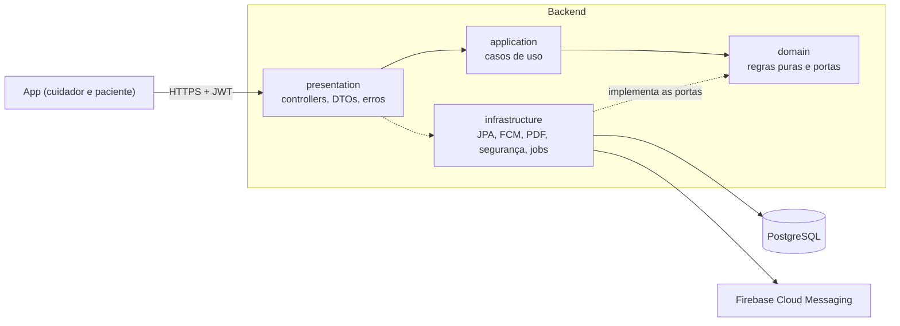
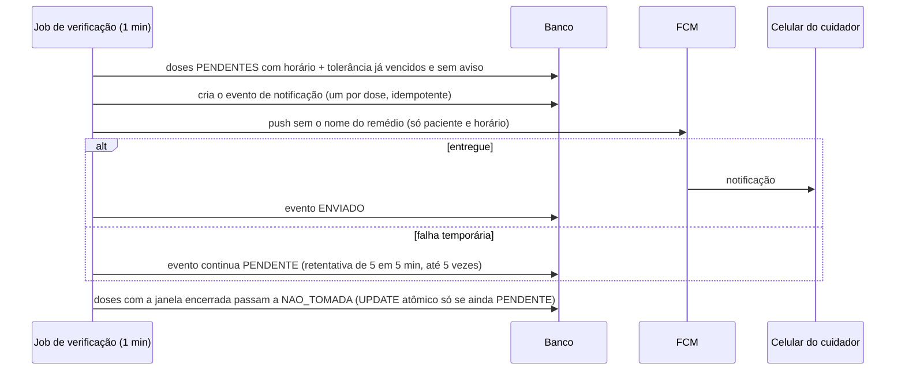

# MedCare Sênior: backend

API do MedCare Sênior, um app de lembrete e registro de remédios pensado para pessoas idosas e usado por qualquer
paciente acompanhado por um cuidador:

- o **cuidador** cadastra pacientes, remédios e tratamentos;
- o **aparelho do paciente**, pareado por um código de 6 dígitos, mostra as doses do dia e confirma cada uma;
- se uma dose não é confirmada a tempo, o cuidador recebe um **aviso push**;
- o cuidador acompanha o relatório do dia, o histórico e o PDF de adesão, e troca mensagens com o paciente.

Java 17, Spring Boot 4, PostgreSQL 16 (Flyway), JWT, Firebase Cloud Messaging, OpenPDF e Caffeine. O app (React
Native/Expo) fica em outro repositório: `medcare-senior-mobile`.

## Arquitetura

Camadas, com as dependências apontando para dentro: o domínio não conhece Spring, banco nem HTTP.



Fluxo do aviso de dose não confirmada (job a cada minuto, com trava do ShedLock para rodar uma vez só):



## Rodar no PC

Pré-requisitos: Docker Desktop, JDK 17 (no IntelliJ: *File → Project Structure → SDK*) e o arquivo `.env` na raiz
(fora do git) com `POSTGRES_USER`, `POSTGRES_PASSWORD` e `POSTGRES_DB`.

```powershell
docker compose up -d                        # PostgreSQL local, com o .env
.\mvnw.cmd spring-boot:run                  # API em http://localhost:8080
```

No IntelliJ, rode `SeniorApplication` com as variáveis do `.env` na configuração de execução (*Run → Edit
Configurations → Environment variables*). Para o push real, acrescente `FCM_ENABLED=true` e
`FIREBASE_CREDENTIALS_PATH` apontando para o JSON da conta de serviço **fora do repositório**.

- **Swagger:** ligado por padrão fora do perfil `prod`, em <http://localhost:8080/swagger-ui/index.html>. Contrato
  exportado em [docs/api/openapi.json](docs/api/openapi.json). A política de exposição está em
  [docs/api/README.md](docs/api/README.md).
- **Saúde:** <http://localhost:8080/actuator/health>.

## Testes

Precisam de um PostgreSQL e das variáveis `POSTGRES_*` no ambiente:

```powershell
Get-Content .env | ForEach-Object { if ($_ -match '^([^#=]+)=(.*)$') { Set-Item "env:$($Matches[1])" $Matches[2] } }
.\mvnw.cmd verify       # 570 testes + JaCoCo (o build falha abaixo de 60% de linhas em domain e application)
```

- **Unidade** (Mockito) para domínio e casos de uso.
- **Integração** com o PostgreSQL real: persistência, concorrência e migrations do zero.
- **API de ponta a ponta** (MockMvc): segurança e contrato do OpenAPI.

Cobertura atual: 99,6% das linhas e 97,6% dos ramos em domain+application; 93% no total.

| Para | Como | Detalhes |
|---|---|---|
| Ver a documentação da API | Swagger UI | [docs/api/README.md](docs/api/README.md) |
| Teste de carga | JMeter por Docker, com massa isolada | [docs/carga/README.md](docs/carga/README.md) e [resultados](docs/carga/resultados.md) |
| Qualidade | SonarQube local (`docker-compose.sonar.yml`) | [docs/qualidade.md](docs/qualidade.md) |
| Implantar | Oracle Cloud Always Free + `deploy/instalar-vm.sh` | [docs/implantacao.md](docs/implantacao.md) |

## Regras de negócio: onde vivem e quem testa

| Regra | Código | Testes |
|---|---|---|
| E-mail do cuidador único | `CadastrarCuidadorUseCase` | `CadastrarCuidadorUseCaseTest` |
| Senha forte (8+ caracteres, maiúscula, minúscula e número) | `CadastrarCuidadorUseCase` | `CadastrarCuidadorUseCaseTest` |
| Termo LGPD aceito no cadastro | `CadastrarCuidadorUseCase` | `CadastrarCuidadorUseCaseTest`, `SegurancaApiTest` |
| Paciente sem duplicata (mesmo nome e nascimento para o mesmo cuidador) | `CadastrarPacienteUseCase` + índice único | `CadastrarPacienteUseCaseTest`, `PersistenciaPostgresTest` |
| Código de vínculo: 6 dígitos, 24 h, uso único; 5 erros em 15 min bloqueiam o IP | `GerarCodigoVinculoUseCase`, `ValidarCodigoVinculoUseCase`, `RateLimiter` | `ValidarCodigoVinculoUseCaseTest`, `RateLimiterTest` |
| Remédio exige nome, dosagem e tipo | `Medicamento` | `CadastrarMedicamentoUseCaseTest`, `EditarMedicamentoUseCaseTest` |
| Remédio com tratamento ativo só sai com confirmação | `RemoverMedicamentoUseCase` | `RemoverMedicamentoUseCaseTest` |
| Tratamento válido (horários sem repetição, dias da semana, período) | `Tratamento` | `TratamentoTest`, `SalvarTratamentoUseCaseTest`, `EditarTratamentoUseCaseTest` |
| Doses geradas numa janela rolante, idempotente | `GeradorDeDosesService` | `GeradorDeDosesServiceTest`, `PersistenciaPostgresTest` |
| Janela da dose (abre 60 min antes; aviso na tolerância; encerra 30 min depois do aviso) | `PoliticaDeJanela` | `PoliticaDeJanelaTest`, `ConfirmarDoseUseCaseTest` |
| Dose registrada nunca muda, nem em confirmações simultâneas | `Dose`, `DoseRepositoryAdapter.registrarSePendente` | `DoseTest`, `ConfirmacaoConcorrentePostgresTest`, `VarreduraConcorrentePostgresTest` |
| Tolerância do cuidador de 5 a 120 minutos | `Tolerancia` | `ToleranciaUseCasesTest`, `PoliticaDeJanelaTest` |
| Cada um só vê o que é seu (404 igual a inexistente) | casos de uso + `SecurityConfig` | `SegurancaApiTest`, `OpenApiContratoTest` |
| Aviso push sem o nome do remédio, com retentativa | `EnvioDeAvisoService`, `PushNotificadorDeDoseNaoTomadaAdapter` | `EnvioDeAvisoServiceTest`, `PushNotificadorDeDoseNaoTomadaAdapterTest`, `RetentativaPostgresTest` |
| Histórico: início não posterior ao fim; período vazio é página vazia | `FiltroHistorico` | `FiltroHistoricoTest`, `HistoricoApiTest` |
| PDF de até 12 meses, com taxa de adesão; período sem doses = 422 | `GerarRelatorioPdfUseCase`, `TotaisDoDia` | `GerarRelatorioPdfUseCaseTest`, `TotaisDoDiaTest`, `RelatorioPdfApiTest` |
| Exclusão de conta apaga os dados pessoais; o histórico fica anônimo | `ExcluirContaUseCase` | `ExcluirContaUseCaseTest`, `PersistenciaPostgresTest` |

## Segredos

- Nenhum segredo vai para o git: `.env`, `deploy/.env.prod`, `deploy/segredos/` e qualquer JSON de conta de serviço
  do Firebase estão no `.gitignore`.
- Em produção, os valores são gerados na própria VM (`instalar-vm.sh --gerar-segredos`) e ficam só no `.env.prod`
  (permissão 600). O perfil `prod` recusa subir com o `JWT_SECRET` ou a senha do banco de desenvolvimento, e a
  mensagem cita só o nome da variável.
- Tokens (GitHub, DuckDNS, SonarQube) nunca entram em arquivo versionado: são pedidos sem eco ou passados por variável
  de ambiente.

## Variáveis de ambiente mais usadas

| Variável | Padrão | Para quê |
|---|---|---|
| `POSTGRES_HOST`, `POSTGRES_PORT`, `POSTGRES_DB`, `POSTGRES_USER`, `POSTGRES_PASSWORD` | localhost, 5432, medcare_db | Banco |
| `DB_POOL_MAX`, `DB_POOL_MIN_IDLE` | 8, 2 | Pool de conexões ([capacidade.md](docs/capacidade.md)) |
| `JWT_SECRET` | valor de desenvolvimento | Obrigatório e forte em produção |
| `APP_TIMEZONE` | America/Sao_Paulo | "Hoje" e "agora" da aplicação |
| `ALERTAS_TOLERANCIA_MINUTOS` | 30 | Tolerância de quem não configurou a sua |
| `ALERTAS_MARGEM_POS_AVISO_MINUTOS` | 30 | Encerramento = aviso + margem |
| `ALERTAS_ANTECEDENCIA_CONFIRMACAO_MINUTOS` | 60 | Quanto antes do horário a dose já pode ser confirmada |
| `DOSES_HORIZONTE_DIAS` | 30 | Doses geradas à frente, em dias (de 1 a 90) |
| `CACHE_RELATORIO_DIARIO_SEGUNDOS` | 30 | Cache do relatório diário (0 desliga) |
| `FCM_ENABLED`, `FCM_DRY_RUN`, `FIREBASE_CREDENTIALS_PATH` | false, false, vazio | Push |
| `JOBS_ENABLED` | true | Varredura de doses, retentativa e reabastecimento |
| `SWAGGER_ENABLED` | true fora do `prod`; false no `prod` | Swagger UI e `/v3/api-docs` |

## Mais documentação

- [docs/implantacao.md](docs/implantacao.md): Oracle Cloud, DuckDNS, `instalar-vm.sh`, backup e restauração e
  checklist de produção.
- [docs/capacidade.md](docs/capacidade.md): capacidade estimada, pool de conexões, planos das consultas, cache e plano B.
- [docs/lgpd.md](docs/lgpd.md): dados pessoais, Google/FCM como operador, retenção e exclusão de conta.
- [docs/termo-consentimento-lgpd.md](docs/termo-consentimento-lgpd.md): texto do termo mostrado no cadastro.
